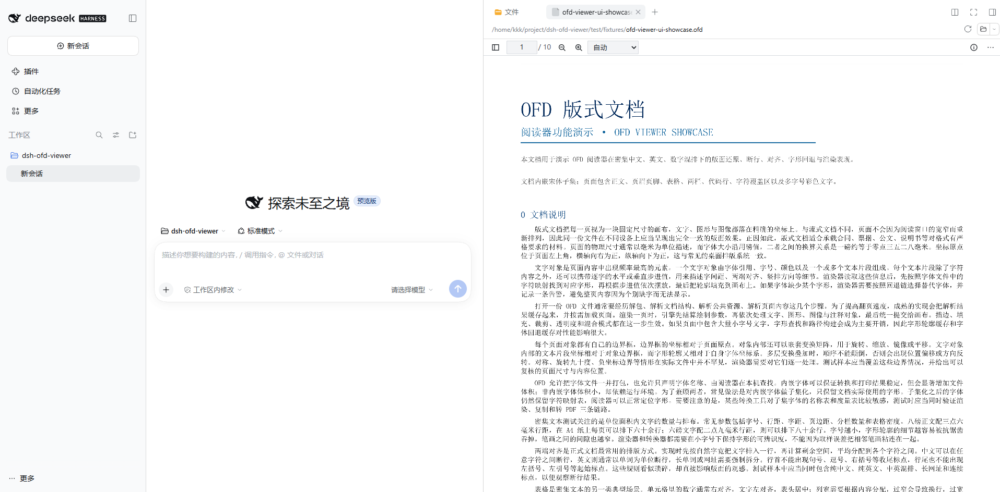

<p align="center">
  
</p>

<h1 align="center">dsh-ofd-viewer</h1>

<p align="center">
  <strong>Read OFD documents right inside DSH</strong><br>
  OFD (GB/T 33190 page-oriented document) preview for DeepSeek Harness Web: open OFD from the Sidebar, a standalone panel and composer attachments, and let the model read OFD with the <code>ofd_read</code> tool.
</p>

<p align="center">
  <a href="https://www.npmjs.com/package/@cliven/dsh-ofd-viewer"></a>
  <a href="https://github.com/Trisia/dsh-ofd-viewer/actions/workflows/ci.yml?query=branch%3Amaster"></a>
  <a href="./LICENSE"></a>
  <a href="./package.json">= 0.2.1-rc.2"></a>
</p>

<p align="center">
  
</p>

English | [中文](README.md)

## What it does

DSH already previews PDF and Word documents, but official documents, e-invoices, contracts and
archives in China are widely distributed as OFD. Before this plugin, a `.ofd` file in the Sidebar was
just binary. With it installed:

- **Read it in the Sidebar**: click a `.ofd` in the file tree, a delivery card or an `@file`
  reference. It sits beside the PDF and Word previews and uses the same preview framework.
- **Preview drafts first**: the composer attachment card carries a **View** button, so a file can be
  read before it is ever submitted to the model.
- **Standalone OFD panel**: pick any local OFD with `＋` in the panel header; toggle between full
  width and an inline card layout.
- **Readable by the model**: the `ofd_read` tool returns the page count, version, document info and
  the text of each page, so "what is the amount on this invoice?" works without rendering.
- **Everything enabled**: continuous scrolling, zoom/rotate, page jump, thumbnails, outline,
  bookmarks, attachments, layer visibility, full-text search, text selection and copy, printing,
  image export, raw OFD export, signature overlays and verification.
- **No missing Chinese glyphs**: Source Han Serif/Sans are bundled, so documents without embedded
  fonts do not come out blank.

The reader is the official npm package
[`@ofdrw/ofdrw-viewer-ui`](https://github.com/ofdrw/ofdrw-viewer/blob/main/packages/ofdrw-viewer-ui/README.md) (MIT)
from [ofdrw-viewer](https://github.com/ofdrw/ofdrw-viewer).

## Install

In DSH, open **Settings → Plugins → Add plugin** and enter the package name and version:

```text
@cliven/dsh-ofd-viewer@0.1.0
```

Or install from the command line:

```bash
dsh plugin --profile web add @cliven/dsh-ofd-viewer@0.1.0
```

The version is pinned to the current release (`0.1.0` right now); to upgrade, replace the number
after `@`.

Restart the DSH Web server and refresh the page afterwards: the client boot graph is composed when
the process starts, so a running process does not pick up a new plugin by itself.

To build from source and link it into a local profile, see
[Development](./docs/DEVELOPMENT.md#link-into-a-dsh-profile).

## Usage

### Three entry points

| Entry | How | Notes |
| --- | --- | --- |
| **Composer attachment** | Drop or pick a `.ofd`, then click **View** on the attachment card | Read a draft before it is submitted; pasted images keep their thumbnails |
| **OFD panel** | `＋` in the panel header to pick a local file | Toggle between full width and an inline card |
| **Sidebar document preview** | Click a `.ofd` in the file tree, a delivery card or an `@file` reference | Sits beside PDF/Word previews and reuses the same framework |

The draft attachment entry point:

<p align="center">
  
</p>

### Reader controls

| Action | Effect |
| --- | --- |
| Wheel / drag | Continuous scrolling through pages |
| Thumbnails, outline, bookmarks | Left rail; click to jump |
| Layers, signatures, attachments | Right rail; signatures support overlay verification |
| Full-text search | Toolbar search box; matches are highlighted and jumpable |
| Text selection | Select and copy text from the page |
| Print, export | Print the document, export images, export the raw OFD |

### The `ofd_read` tool

The tool the model calls:

| Parameter | Type | Description |
| --- | --- | --- |
| `path` | string, required | OFD path; relative paths resolve against the Session working directory |
| `pages` | string | Page selection such as `"3"`, `"1-5"` or `"1,3,7-9"`; append a character slice such as `"4#2001-4000"` or `"4-6#1-500"`; omit for the first pages |
| `maxPages` | integer | Maximum pages of text to return, default 30 |
| `maxCharsPerPage` | integer | Maximum characters returned per page (counted as Unicode characters), default 4000 |
| `includeText` | boolean | `false` returns metadata only, default `true` |

It returns the page count, OFD version, document info (DocInfo), `returnedPages`, the text of each
page and any entries that failed to decompress.

**Long pages lose nothing**: a page longer than `maxCharsPerPage` comes back in segments, and each
page carries `offset` (the character position this segment starts at), `totalChars` (the page
length), `hasMore`, and a `next` value to feed straight back into `pages`:

```json
{ "page": 4, "offset": 1, "totalChars": 5170, "hasMore": true, "next": "4#4001-5170" }
```

Passing `next` back reads the rest of that page; concatenated in order, the segments equal the whole
page. Characters are counted as Unicode code points, so rare CJK characters and emoji count as one
character and no character is ever split in half.

## More

- Data flow, slots and design trade-offs: [design notes](./docs/DESIGN.md)
- Build, release and debugging: [Development](./docs/DEVELOPMENT.md)
- Missing preview, missing glyphs, dark theme: [FAQ](./docs/FAQ.md)

## License

The plugin code is released under the [MIT License](./LICENSE), Copyright (c) 2026 Quan Guanyu.

The bundled Source Han Serif/Sans fonts are under the SIL Open Font License 1.1 (sources and subset
ranges in [assets/fonts/NOTICE.md](./assets/fonts/NOTICE.md)); the reader
`@ofdrw/ofdrw-viewer-ui` is also MIT.
