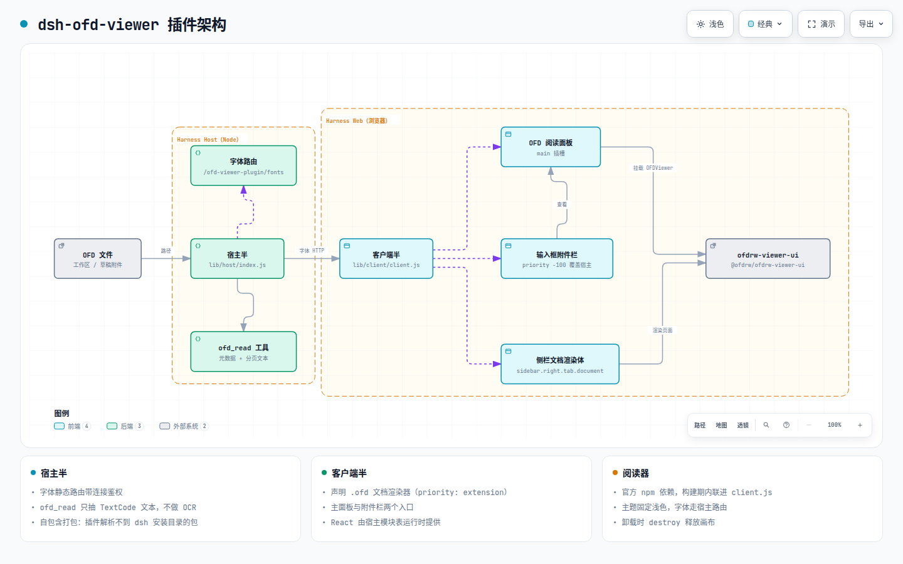
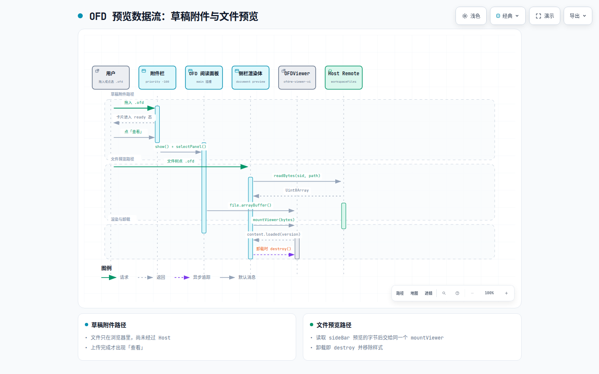

# dsh-ofd-viewer 设计文档

> 本文记录插件的设计决策与实现边界。面向需要维护、排查或二次开发的读者；
> 只想安装和使用的读者请看 [README](../README.md)。

## 1. 目标与约束

**目标**：让 DeepSeek Harness 的 Web 界面可以直接预览 OFD（GB/T 33190 版式文档），
并让模型无需渲染即可读到 OFD 的文字与结构。

**硬约束**（决定了下面所有设计）：

| 约束 | 来源 | 影响 |
| --- | --- | --- |
| 浏览器插件以 `window.__ModuleLoader__.load({ id, factory })` 登记，`factory` 必须返回**函数或带 `apply` 的对象** | Harness 客户端模块系统 | 产物不能直接输出 `module.exports`，必须包一层工厂壳 |
| 浏览器模块表只内置 React、zod、cordis 等白名单模块 | `dsh-web-frontend` 的 `PLATFORM_MODULES` | 第三方库（官方阅读器）无法靠模块表解析，必须打进产物或自带 |
| 宿主 SDK（cordis、`dsh-fs`、`dsh-tools` 等）版本随 DSH 安装变化，内联后会与宿主运行期不一致 | DSH 快速迭代 | 宿主半把这些包留作裸 import，由 profile 的 `node_modules` 解析（与官方插件一致） |
| 客户端模块不允许 import 宿主客户端包（只能在构建期用类型） | 插件规范 | 组件与插槽类型自持，或用 `import type` |
| 单值插槽的覆盖**必须显式给更低 priority**，数值最低者渲染 | Cordis 插槽系统 | 接管宿主附件栏需要 `priority: -100` |
| `ctx.get(name)` 不能取未注入的必需服务 | Cordis 注入 | `layout` 必须写进 `inject` |

## 2. 总体结构



交互版：[`architecture.html`](./diagrams/architecture.html)（可缩放、搜索、切换深浅色、导出）。
图源：[`architecture.architecture.json`](./diagrams/architecture.architecture.json)。

Harness Host 侧是宿主半（字体路由 + `ofd_read`），Harness Web 侧是客户端半
（声明渲染器、主面板、附件栏），二者共同驱动 `ofdrw-viewer-ui`。

**两半各自独立**：宿主半没有客户端半也能工作（`ofd_read` 与字体路由），
客户端半没有宿主半时字体 404 但阅读器仍可用（缺字回退到宿主机/内嵌字体）。

## 3. 客户端半设计

### 3.1 模块登记：工厂壳

Harness 只接受函数或带 `apply` 的对象，而 esbuild 的 IIFE 产物自带作用域，
所以 `scripts/build.mjs` 用 `HEADER`/`FOOTER` 把产物包成：

```js
window.__DSH_MODULE_LOADER__ ??= window.__ModuleLoader__;
window.__ModuleLoader__.load({
  id: '@cliven/dsh-ofd-viewer',
  factory: (require) => {
    var __dshRequire = require;                    // 宿主模块加载器
    globalThis.__DSH_OFD_VIEWER_REQUIRE__ = require;
    var __DSH_ENTRY_MODULE__;
    /* ---------- esbuild IIFE 产物 ---------- */
    var entry_default = registerPlugin;
    return entry_default();                       // 在 IIFE 内取出插件模块面
    /* -------------------------------------- */
    return __DSH_ENTRY_MODULE__;                  // 工厂最终返回值
  },
});
```

两个细节：

- **入口调用必须放进 IIFE 内部**：esbuild 的 IIFE 以 `\n})();` 收尾（后面还可能跟版权注释），
  所以构建脚本用 `insertEntryReturn()` 在最后一个 `\n})();` 之前插入 `return entry_default();`，
  再用外层变量 `__DSH_ENTRY_MODULE__` 把结果带回工厂作用域。
  直接把 `return` 写在 IIFE 外会拿到 `undefined`，模块加载器会报
  `invalid plugin, expect function or object with an "apply" method, received object`。
- **React 在运行时取用**：`src/commonjs.ts` 提供 `requireModule(specifier)`，
  渲染时才 `require('react')`，因此 bundle 加载期不会触碰宿主模块表。

### 3.2 React 与 JSX 运行时

构建时 `HOST_MODULES` 插件把：

- `import ... from 'react'` 改写成 `const m = __dshRequire('react'); export const ... = m.xxx`
- `react/jsx-runtime` 同理

这样组件里可以直接写 JSX，运行时由宿主模块表提供 React（不重复打包）。

> 历史教训：最初把 React 直接 external 成静态 `import`，bundle 变成 ESM，
> 一旦有代码分块就会在工厂函数体里出现 `import` 语句 —— 语法错误。
> 现在的做法是 **IIFE + 独立 require 访问器**，产物里没有任何顶层 ESM 语句。

### 3.3 阅读器集成

- **依赖**：`@ofdrw/ofdrw-viewer-ui` 是普通 npm 依赖，构建时内联为 `lib/client/client.js`
  （约 3.3 MB）。曾经手写过 CJS→ESM 包装层（转换官方产物 + 自定义 CommonJS 运行时），
  因为官方产物包含运行时 `import('fflate')` 与 getter 自引用导出，维护成本高且脆弱，已废弃。
- **选项**（`src/client/viewer.ts`）：`locale: 'zh-CN'`、`theme: 'light'`、`supersample: 'high'`，
  字体走宿主路由，缺字回退思源宋体/黑体。
  `theme` 固定浅色是刻意的：深色宿主下若用 `auto`，白色纸张与工具栏浅色文字会看不清（已实测）。
- **字节**：传入前复制成同源 `Uint8Array`，避免被引擎当作其它 realm 的视图。
- **生命周期**：`mountViewer()` 返回清理函数，组件卸载时 `destroy()` + 移除样式 + 清空容器。

### 3.4 四个入口

| 入口 | 插槽 | 要点 |
| --- | --- | --- |
| 文档预览声明 | `ctx.get('documentPreviews').register()` | `extensions: ['ofd']`、`binaryExtensions: ['ofd']`、`priority: 'extension'`、`loading: 'renderer'` |
| 文档渲染体 | `sidebar.right.tab.document`（keyed，key = 实现 id） | 用 `props.content.loaded()/failed()` 反馈加载状态；`scrollportRef` 上报自己的滚动容器 |
| 主面板 | `main`（keyed，key = `ofd-viewer`） | 读取当前会话「待预览 OFD」；无会话时回退到最近一次选择 |
| 输入框附件栏 | `conversation.input.attachments`（single） | **`priority: -100` 覆盖宿主实现**；保留拖放、移除、重试等宿主行为 |
| 图片缩略图 | 同上（附件栏内部） | 图片类草稿按其 `previewUrl` 渲染 64×64 缩略图，点击弹出原图灯箱（Esc 关闭） |
| 文件卡片 | 同上（附件栏内部） | 非图片附件渲染文件卡片；`.ofd` 卡片额外提供「查看」 |

附件栏接管是"覆盖而非新增"，因此必须完整还原宿主的全部形态：图片缩略图与原图灯箱、
文件卡片（文件名、大小、移除、上传进度、重试）、拖放遮罩文案，否则会丢失宿主原有交互。
宿主 `ComposerAttachments` 主动按 `kind` 分流，草稿附件因此分为两类：
`file` 带 `File`，`image` 另带 `previewUrl`（宿主生成的本地对象 URL），缩略图直接用它渲染。

## 4. 宿主半设计

### 4.1 宿主包外部引用

`lib/host/index.js` 只把本仓库自己的代码与 `dsh-ofd` 无关的小工具打进产物；
`@deepseek-ai/cordis`、`dsh-fs`、`dsh-tools`、`dsh-llm`、`dsh-typert-protocol`
由 `scripts/build.mjs` 的 `HOST_EXTERNALS` 标记为 external，保留 `import` 语句，
运行期由 profile 的 `node_modules` 解析（`package.json` 的 `dependencies` 声明了这些版本）。

早期版本把宿主包内联进来，并用构建期常量替换
`createRequire(import.meta.url)("../package.json")`。这样做的问题在宿主升级后暴露：
内联的 `dsh-llm`/`dsh-typert-protocol` 与宿主自身版本不一致时，插件在加载阶段就直接失败
（`optional dependency @deepseek-ai/dsh-typert-protocol is unavailable`），
且宿主半不激活时，浏览器半拿不到 `documentPreviews`，侧栏点击 .ofd 会显示
「该格式文件暂时无法预览」。

### 4.1.1 加载顺序（与 documentPreviews 的时序竞争）

浏览器半注册 .ofd 渲染器时必须拿到 `documentPreviews` 服务，它由
`@deepseek-ai/dsh-client-ui-sidebar-documentpreview` 在自己的 apply 中提供。

**启动表顺序不等于执行时序。** 启动图的 `entries` 顺序由 Cordis 依赖排序决定，
但 `client-modules` 在发送脚本前会按 **combo URL 的字节长度**把插件切成多个
`application` 批次（`partitionComboRecords`），每个批次用独立的
`<link rel="preload">` 并行下载。批次之间没有先后保证，`dsh.client.inject`
也只在同一批次内生效。本插件与文档预览分属不同批次时，插件 apply 时
`documentPreviews` 可能还不存在。

因此顺序处理分两层，**以第二层为准**：

- 排序层（尽力而为）：宿主半 `inject` 声明 `clientModules`，让本插件的行在同批次内
  排到文档预览之后；`package.json` 的 `dsh.client.inject` 声明对
  `@deepseek-ai/dsh-client-ui-sidebar-documentpreview` 的依赖。
- 运行时层（兜底）：`watchDocumentPreviews` 在 apply 时拿不到服务就按
  50 毫秒间隔轮询（最多 120 次），服务出现后再登记，超时则打印明确错误。
  回归测试见 `test/client-timing.test.mjs`。

**不要用 `cordis.patch.yml` 插入 `ui-sidebar-documentpreview`。** 该行由宿主
`@deepseek-ai/dsh-web-app` 的补丁层无条件插入，本包重复 insert 只是多余的；
更严重的是，`dsh-plugin-manager` 卸载组合包时会把补丁声明的行计入本包组件清单，
再检查其中是否有存活 fiber——宿主组件始终在运行，于是必然抛 `bundle-in-use`
（「其他配置仍在使用这个组合包的组件，请先停用它们」），插件从此无法卸载。
回归测试见 `test/manifest.test.mjs`。

早期版本只在 apply 时查一次 `ctx.get('documentPreviews')`，服务晚到就永久跳过注册，
表现为侧栏点 .ofd 显示「该格式文件暂时无法预览」。

### 4.2 字体路由

`prefix /ofd-viewer-plugin/fonts`：

- 先调 `connection.requestRejection(req)`，非本机来源直接按拒绝状态应答（未鉴权为 401）；
- 只接受 `GET`/`HEAD`；文件名白名单在 `FONT_FILES`；
- 响应 `font/woff2`、`cache-control: private, max-age=86400`。

路由注册在 `ctx.root.effect()` 上：插件自身上下文在 `apply` 结束后可能被卸载，
挂在上面会导致路由随之下线（调试时踩过）。

### 4.3 `ofd_read` 工具

输入：`path`（必填）、`pages`（`"3"` / `"1-5"` / `"1,3,7-9"`，可带页内区间 `"4#2001-4000"`）、
`maxPages`（默认 30 页）、`maxCharsPerPage`（默认 4000 字符）、`includeText`。
输出：`path`、`bytes`、`version`、`docInfo`、`pageCount`、`returnedPages`、`pages[]`、
`maxCharsPerPage`、`skippedEntries`。

文本抽取（`src/host/ofd-read.ts`）只用 Node 内置 `zlib`：

1. 读 ZIP 中央目录（找 EOCD → 逐条目录项）；
2. 只解压需要的条目（deflate/stored），单条上限 64 MiB；
3. `OFD.xml` → 版本、`DocInfo`、`DocRoot`；
4. `DocRoot/Document.xml` 的 `Pages/Page[BaseLoc]` 给出页序；
5. 每页 `Content.xml` 中按出现顺序抽取 `<ofd:TextCode>` 文本并解实体。

**长页分段而不是截断**：一页超过 `maxCharsPerPage` 时按段返回，每页带 `offset`（本段起始
字符数，从 1 起）、`totalChars`（本页总字符数）、`hasMore`，以及可直接回传 `pages` 的
`next`（形如 `"4#4001-5170"`）。字符计数按 Unicode 码点（`Array.from(text)`），因此长页
可以分段读完整，且不会把代理对切成半个字符。

这是**纯文本抽取，不做 OCR**，扫描件需要 MinerU 一类工具。

## 5. 数据流



交互版：[`preview-flow.html`](./diagrams/preview-flow.html)。
图源：[`preview-flow.sequence.json`](./diagrams/preview-flow.sequence.json)。

两条路径共用同一个 `mountViewer`，差别只在字节来源。

**路径一 · 草稿附件（未提交）**

```
拖入/选择 .ofd → 宿主草稿附件（浏览器 File 对象）
  → 本插件附件栏渲染「查看」按钮（仅 ready 态可用）
  → store.show(sessionId, file) + layout.selectPanel('ofd-viewer')
  → 主面板读登记表 → file.arrayBuffer() → mountViewer()
```

**路径二 · 已提交文件（右侧栏预览）**

```
文件树 / 交付卡片 / @文件 引用
  → sidebarRight.openResource('dsh-resource://file/session/<sid>/<path>')
  → 文档预览按后缀选中渲染器（@cliven/dsh-ofd-viewer/ofd）
  → 渲染体 ctx.get('remote.workspaceFiles').readBytes(sid, path)（需要全量字节）
  → content.loaded(version) / content.failed() 反馈加载状态
  → mountViewer()
```

Remote 命名空间在宿主侧是服务名含点的独立服务（`remote.workspaceFiles`），插件必须把
`'remote.workspaceFiles'` 写进 `inject` 并用 `ctx.get('remote.workspaceFiles')` 取。
`ctx.remote.workspaceFiles` 不能用：`remote` 只是命名空间前缀、本身不是已提供的服务，
这样写会在取属性时抛 `cannot get property "remote.workspaceFiles" without inject`。

草稿附件尚未经过 Host，只能走浏览器 `File` 对象；因此「查看」只在卡片上传完成（`ready`）时可用，
失败态提供重试。

## 6. 扩展点清单

| 扩展点 | 用法 |
| --- | --- |
| `documentPreviews.register()` | 声明接管 `.ofd` |
| `main` / `sidebar.right.tab.document` / `conversation.input.attachments` | 界面入口 |
| `ctx.locale.register('ofdViewer', { zh, en })` | 全部可见文案 |
| `ctx.layout.selectPanel()` | 切换主面板 |
| `webServer.register()` | 字体静态资源 |
| `tools.register()` | `ofd_read` |

## 7. 备选方案与取舍

| 方案 | 结论 |
| --- | --- |
| 用 iframe 承载阅读器 | 否：拿不到宿主主题、locale，也无法复用插槽 |
| 每次渲染都从 `?file=`/`?base64=` 走官方 URL 加载 | 否：`?base64=` 有 64 MiB 上限且会进入历史/日志；文件本就在会话文件系统里 |
| 手写 CJS→ESM 包装层承载官方产物 | 已废弃：见 3.3 |
| 用 `queryLocalFonts` 作为唯一字体源 | 否：仅 Chromium 且需授权，非 Chromium 或缺字时整页空白 |
| 附件栏新增一个独立区域而不是覆盖 | 否：单值插槽只有一份，宿主已在渲染附件轨道 |
| 客户端类型用宿主 `SlotMap`/`PropsRuntime` | 部分可行：`@deepseek-ai/dsh-client-ui-slots` 与 `dsh-client-ui-session` 在 npm 上可装；但 `dsh-client-ui-conversation`、`-sidebar-right`、`-sidebar-documentpreview`、`-layout` 未发布到 npm（只随 dsh 安装分发，其中 documentpreview 体积 15 MB），拿不到它们的 `declare module` 合并，`PropsRuntime<'...'>` 会退化成 `{}`。当前实现自持最小契约（`src/client/contracts.ts`）。 |

## 8. 风险与已知边界

- **体积**：内置字体约 19 MB，阅读器内联约 3.3 MB。删除 `assets/fonts/` 并去掉字体路由可瘦身，但会牺牲缺字文档的可读性。
- **文本抽取覆盖面**：只处理 `TextCode`；路径文字、图像内文字、扩展区生僻字不保证。
- **主题**：阅读器固定浅色，与宿主深浅色不完全一致（刻意取舍，见 3.3）。
- **加载策略**：阅读器随客户端 bundle 一次性加载（未做分块懒加载），首次打开编辑器的包体较大。
- **多实例**：同一个 OFD 在多个侧栏标签页各建一个 `OFDViewer` 实例，内存随实例数线性增长。
- **草稿附件**：依赖宿主草稿状态；未通过宿主校验的文件不会进入卡片。

## 9. 验证方式

- `npm run typecheck`：tsc 严格模式；
- `npm test`：文件名判断、资源地址解析、OFD 文本抽取、清单/补丁一致性；
- 浏览器实测（曾用独立 `DSH_HOME` + `playwright-cli` 完成）：
  插件进入启动图 → 附件栏被接管 → 「查看」打开面板 → 官方阅读器渲染出 10 页文档
  （工具栏、缩略图、大纲、签章、附件、图层齐全），浅色/深色宿主均正常；字体路由返回 200。
